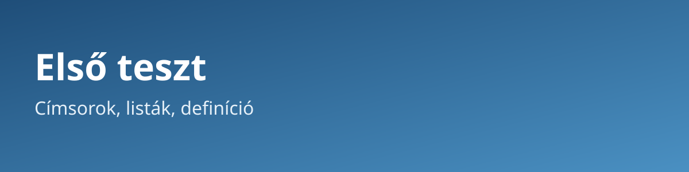

Első teszt: címsorok, listák, definíció
=======================================
.. post:: 2026-11-05
   :tags: teszt, szerkezet, rst
   :author: Salty

Ez a bejegyzés a szerkezeti elemeket teszteli: a címsorokat több mélységben,
a listákat, a definíciót, a táblázatot és a hivatkozásokat. A jobb oldali
sávban a címsorok szerint kell tudni navigálni.

.. _elso-szerkezet:

Címsorok több mélységben
------------------------

Ez egy másodszintű cím alatti bekezdés.

Harmadik szint
~~~~~~~~~~~~~~

Ez egy harmadszintű cím alatti bekezdés.

Negyedik szint
^^^^^^^^^^^^^^

Ez egy negyedszintű cím alatti bekezdés.

Egy másik harmadik szint
~~~~~~~~~~~~~~~~~~~~~~~~

Ez ellenőrzi, hogy a testvér-címsorok is megjelennek a jobb oldali sávban.

Listák
------

Számozatlan felsorolás
~~~~~~~~~~~~~~~~~~~~~~

* Első elem
* Második elem

  * Beágyazott elem
  * Másik beágyazott elem

* Harmadik elem

Számozott felsorolás
~~~~~~~~~~~~~~~~~~~~

1. Első lépés
2. Második lépés

   1. Al-lépés
   2. Másik al-lépés

3. Harmadik lépés

Definíció
---------

Definíciós lista
~~~~~~~~~~~~~~~~

prímszám
    Olyan 1-nél nagyobb természetes szám, amelynek pontosan két pozitív
    osztója van: az 1 és önmaga.

összetett szám
    Olyan 1-nél nagyobb természetes szám, amely nem prím.

Kiemelt definíció
~~~~~~~~~~~~~~~~~

.. admonition:: Definíció (páros szám)

   Egy $n$ egész szám *páros*, ha létezik olyan $k$ egész szám, hogy
   $n = 2k$.

Táblázat
--------

.. list-table:: A tesztelt elemek
   :header-rows: 1
   :widths: 25 45 30

   * - Elem
     - RST megoldás
     - Hol ellenőrizzük?
   * - Címsor
     - aláhúzott szöveg
     - jobb oldali sáv
   * - Felsorolás
     - ``*`` és ``1.`` jelölés
     - a bejegyzés törzse
   * - Képlet
     - ``$...$`` és ``.. math::``
     - a második bejegyzés

Hivatkozások
------------

* Külső hivatkozás: `a Sphinx dokumentációja <https://www.sphinx-doc.org/>`__.
* Belső hivatkozás címsorra: :ref:`ugrás a címsorokhoz <elso-szerkezet>`.
* Hivatkozás a másik bejegyzésre: :doc:`masodik-teszt`.