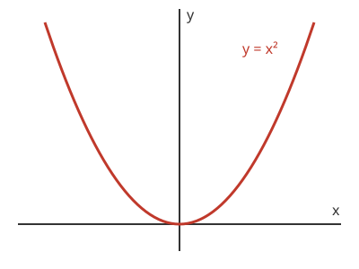

Második teszt: képletek, programkód, ábra
=========================================

Ez a bejegyzés a matematikai képleteket, a programkódot és az ábrát
teszteli. A szerkezeti elemek az :doc:`elso-teszt` bejegyzésben vannak.

Matematikai képletek
--------------------

Szövegbe ágyazott képlet
~~~~~~~~~~~~~~~~~~~~~~~~

Legyen $f\colon \R \to \R$, $f(x) = x^2$, és legyen $n \in \N$. A szöveg
közben álló képlet a sor magasságához igazodik.

Kiemelt képlet
~~~~~~~~~~~~~~

A másodfokú egyenlet megoldóképlete:

.. math::

   x_{1,2} = \frac{-b \pm \sqrt{b^2 - 4ac}}{2a}

Többsoros levezetés
~~~~~~~~~~~~~~~~~~~

Az euklideszi algoritmus lépései a 48 és a 18 számra:

.. math::

   \begin{aligned}
   48 &= 2 \cdot 18 + 12 \\
   18 &= 1 \cdot 12 + 6 \\
   12 &= 2 \cdot 6 + 0
   \end{aligned}

Az utolsó nem nulla maradék a legnagyobb közös osztó, tehát
$\gcd(48, 18) = 6$.

Programkód
----------

Python
~~~~~~

Az euklideszi algoritmus Pythonban:

.. code-block:: python

   def lnko(a: int, b: int) -> int:
       """Két egész szám legnagyobb közös osztója."""
       while b != 0:
           a, b = b, a % b
       return abs(a)

   print(lnko(48, 18))  # 6

Parancssor
~~~~~~~~~~

.. code-block:: bash

   uv run sphinx-build -W -b html source build/html

Ábra
----

   Az $f(x) = x^2$ függvény grafikonja.

Összefoglalás
-------------

Ha minden elem megjelent, a képletek, a kód és az ábra rendben működnek.